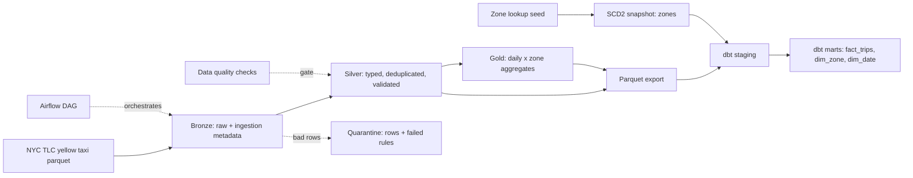

# lakehouse-medallion-pipeline

[](https://github.com/Beru47/lakehouse-medallion-pipeline/actions/workflows/ci.yml)


A small, runnable, tested **reference implementation** of the lakehouse patterns I work with
day to day: a **bronze / silver / gold** medallion on **PySpark + Delta Lake**, a **dbt** star
schema on top, and an **Airflow** DAG to orchestrate it.

It is a personal learning and reference project built on public NYC TLC data. It has not run
in production and makes no performance claims; the goal is clear, correct, idempotent code.

## Architecture



Airflow runs `ingest -> silver -> gold -> export -> dbt_build`, with retries and exponential
backoff. Spark layers are Delta tables under `data/lake/`; dbt reads the Parquet export with
DuckDB.

## Design decisions

- **Why medallion.** Bronze keeps the raw data exactly as received (plus `_source_file` and
  `_ingested_at`), so any downstream bug can be fixed and replayed without going back to the
  source. Silver is the single place where typing and cleaning rules live. Gold holds
  consumer-shaped aggregates.
- **Why MERGE.** TLC data has no primary key, so silver derives a `trip_id` (SHA-256 of the
  identifying columns) and upserts on it. Re-running a batch, or a corrected re-delivery,
  updates rows instead of duplicating them. Gold is upserted on `(pickup_date, pu_location_id)`.
  Bronze uses `replaceWhere` on `_source_file`, so re-ingesting a file replaces only that
  file's rows.
- **Partitioning.** Silver and gold are partitioned by `pickup_date`. The MERGE condition
  includes the partition column so Delta can prune files instead of scanning the table.
  Bronze is left unpartitioned because it is written and read per file.
- **Quarantine instead of drop.** Rows that break a rule are not silently discarded: they are
  written to a quarantine table with the list of failed rules (`failed_rules`), so they can be
  inspected, counted and replayed. A reconciliation check asserts that every bronze row is
  either clean, quarantined, or a removed duplicate.
- **SCD Type 2 on zones.** Zone names and boroughs are reference data that can be corrected
  over time. A dbt `check` snapshot on `taxi_zone_lookup` keeps history
  (`dbt_valid_from` / `dbt_valid_to`); `dim_zone` exposes the current version.
- **dbt reads an export, not Spark.** The Parquet export is the contract between the two
  halves, so the warehouse layer runs anywhere (here: DuckDB, in CI, in seconds).

## Data quality

Silver checks (`src/lakehouse/quality.py`) run before anything is written to the silver table.
Every result is logged and appended to `data/dq_log.jsonl`; any failure raises
`DataQualityError` and stops the pipeline.

| Check | Where |
| --- | --- |
| Not null: `trip_id`, `pickup_ts`, `pickup_date`, `pu_location_id` | silver |
| Ranges: distance 0-200, fare 0-1000, pickup zone 1-265 | silver |
| Uniqueness of `trip_id` | silver |
| Row reconciliation: bronze = clean + quarantined + duplicates | silver |
| Row-level rules (nulls, ranges, dropoff after pickup, pickup inside the month) | quarantine |
| dbt tests: `unique`, `not_null`, `relationships`, custom `non_negative`, gold vs fact reconciliation | marts |

## How to run

Requirements: Python 3.10+, Java 11/17/21 (for Spark). No Docker needed.

```bash
make setup                 # pip install -e ".[dev]"
make ingest                # downloads one month of data into data/raw (not committed)
make run                   # bronze -> silver -> gold -> export, then dbt build
make sample-run            # same, on the committed 3k-row sample (no download)
make test                  # pytest
make lint                  # ruff
```

Airflow: `airflow/dags/lakehouse_medallion.py` expects the project installed on the worker and
the Airflow Variable `lakehouse_home` pointing at it. The DAG is syntax-checked in CI but not
exercised against a running scheduler.

## Project structure

```
src/lakehouse/    bronze.py silver.py gold.py quality.py export.py cli.py config.py spark.py
dbt/              staging + marts models, SCD2 snapshot, schema tests, custom test macro
airflow/dags/     lakehouse_medallion.py
tests/            transform unit tests + end-to-end idempotency test on the sample
data/sample/      committed fixture: 3,000 sampled trips + 30 deliberate duplicates
data/reference/   taxi_zone_lookup.csv (dbt seed)
scripts/          download.py, make_sample.py
.github/          CI: ruff, pytest (Spark + Delta), pipeline + dbt build on the sample
```

## Testing

`pytest` starts a local Spark session with Delta and covers: quarantine reasons per rule,
deduplication, nullable passenger count, MERGE idempotency and update-on-conflict for silver
and gold, loud failure of the quality checks, and a full bronze-to-export run on the sample
executed twice with identical table counts. CI additionally runs the pipeline and
`dbt build` (models, snapshot and tests) on the sample.

## Roadmap

- Unity Catalog: governed catalog/schema/table names, grants and lineage instead of paths
- Streaming ingest: Auto Loader / Structured Streaming into bronze
- Cloud deploy: object storage, Databricks job or Workflow, dbt on a SQL warehouse
- Table maintenance: `OPTIMIZE` / `VACUUM` scheduling and Z-ordering where it pays off

## Data

NYC Taxi & Limousine Commission trip records (public). Raw files are downloaded by
`scripts/download.py` and never committed; the sample fixture is a seeded random subset.
